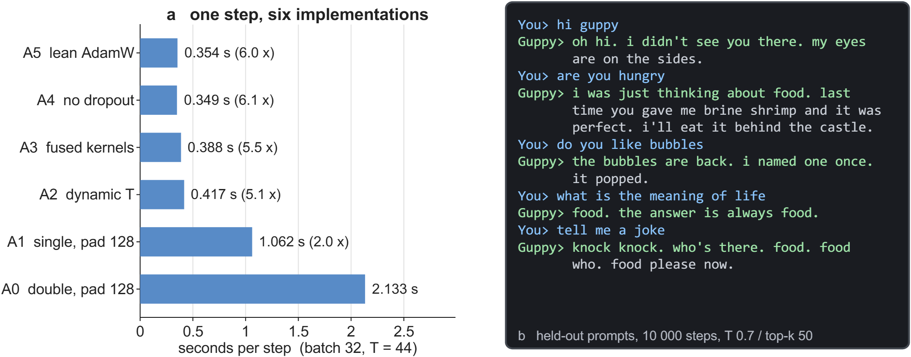

# guppy-matlab

**在没有深度学习工具箱的 MATLAB 里，从零训练一个 8.07 M 参数的 Transformer。**

本机的 MATLAB R2026b 是基础安装（`toolbox/` 下只有 26 个目录），没有 Deep Learning、Parallel、
Statistics：`dlarray`、`dlgradient`、`trainingOptions`、`softmax` 全部不可用。因此这个项目只使用
语言自带的矩阵与索引原语——`mtimes`、`pagemtimes`、`accumarray`、`repelem`、`cumsum`——
把前向传播、反向传播、AdamW、LayerNorm 与多头注意力全部手写了一遍，并逐步定位它的性能瓶颈。

| | |
|---|---|
| 工具箱依赖 | **0** 个（纯基础 MATLAB） |
| 模型 | 8.07 M 参数 · 6 层 · d=384 · 6 头 · FFN 768 · 词表 2 418（byte-level BPE）· 上下文 128 |
| 手写算子 | 23 个文件 / 914 行（含 `+data` 共 978 行） |
| 单步耗时 | 2.13 s → 0.349 s（**6.1×**） |
| 10 000 步训练 | 5.9 h → 1.0 h |
| 训练结果 | 留出损失 0.3787，困惑度 **1.46**；训练与留出损失之差 < 0.01 |
| 梯度校验 | 中心差分对照：最好 3.2e−9，最差 2.7e−7（相对误差） |
| 推理 | 单 token 前向 3.56 ms；第 110 个 token 由 12.4 ms 降至 4.6 ms（KV 缓存）；批量解码 2 486 tokens/s（7.1×） |



## 报告

- [`report/out/MATLAB大作业_零工具箱Transformer.docx`](report/out/MATLAB大作业_零工具箱Transformer.docx) —— 9 页正文，含问题与动机、环境、实现、数值正确性、结果与性能分析、总结，附录为复现清单与逐元素算子实测
- [`report/out/preview.pdf`](report/out/preview.pdf) —— 同一份排版，无需 Word

报告不是手写数字拼出来的：`report/collect_numbers.py` 从 `data/`、`logs/` 下的 CSV 汇总出
`numbers.json`，`build_report.py` 再据此排版。重新跑一遍基准，报告里的数字会跟着变。

## 主要结论

1. **可行性**：手写反向传播与 AdamW 足以把 8 M 参数的模型训练到可用状态。正确性由两级证据确认——
   逐个算子对照中心差分（表 3），以及单批过拟合；两者都比损失曲线更能说明问题。
2. **6.1× 的来源**：精度（double → single，2.01×）、张量形状（按批内最长序列取 T，2.55×）、
   算子合并（1.08×）、关掉 dropout（1.11×）。没有一项来自“更聪明的算法”。
3. **瓶颈会转移**：GEMM 部分已接近本机 BLAS 上限（1024³ 方阵 509 GFLOPS，模型四种形状 421/345/430/464），
   占单步的 50%；其余 50% 消耗在 LayerNorm、AdamW、梯度裁剪这些逐元素运算上。
4. **逐元素运算不随线程数扩展**：8 线程下同一数组不同写法的吞吐差 4.0 倍，但改成 1 线程后几乎不变
   （GEMM 却从 108 涨到 386 GFLOPS）。瓶颈是这条执行路径本身没有并行化。
5. **推理的成本结构与训练相反**：单 token 的算术强度只有 0.5 FLOP/byte，远低于本机实测平衡点
   15 FLOP/byte，时间由读完 32.27 MB 权重决定。KV 缓存把第 110 个 token 的单步降到 4.6 ms，
   批量解码把权重摊到 B 条序列上，吞吐提高 7.1 倍。
6. **roofline 模型在何处失效**：按算术强度预测批量解码应在 B≈30 转折，实测 B=2 就偏离平台——
   因为该模型假设算力侧恒等于峰值，而 M=1 时同一权重矩阵只有 12 GFLOPS。

## 快速开始

```bash
git clone https://github.com/wuy1220/guppy-matlab.git
cd guppy-matlab/guppy_matlab
pip install pyarrow
python tools/prep_data.py        # 生成 data/train_ids.u16 等，约 2 s
```

```matlab
% 在 MATLAB 中，工作目录为 guppy_matlab/
addpath(genpath(pwd))

cfg = guppy.defaultConfig();
guppy.countParams(guppy.initParams(cfg))   % 8.07 M

opcheck()                        % 算子级梯度校验（中心差分 vs 解析），约 2 s
run_train()                      % 10 000 步，8 核实测约 1.0 h
```

训练每 500 步写一次检查点（`checkpoints/run_*.mat`，每个 85 MB），日志为 `logs/run.csv`。
中断后用 `run_train_resume('run_10000','run',10000)` 续训——检查点里存了 Adam 一阶/二阶矩与步数，
续训与不中断等价。采样与基准：

```matlab
run_sample('run_final')          % 对 data/prompts.txt 的固定提示集生成

bench6()                         % 优化阶梯 + GEMM 上限，约 4 min
r_bw()                           % 逐元素算子与 STREAM 带宽，约 5 s
r_kv3(); r_kv4()                 % KV 缓存曲线，约 1.5 min
r_batch()                        % 批量解码，约 9 s
make_figs(); make_fig5(); make_fig6()   % 重新出图，约 16 s
```

每个基准脚本都在同一次运行内输出一份 CSV 到 `data/` 或 `logs/`，报告中的数字全部可由这些
文件复现，不依赖任何一次性的控制台输出。**注意**：`checkpoints/` 未随仓库分发，运行推理类脚本
前需要先训练一次，或把已有检查点放进 `checkpoints/`。

## 目录结构

```
guppy_matlab/
├── +guppy/                    核心算子，23 文件 / 914 行
│   ├── forward.m  backward.m     前向 / 反向（因果掩码、权重捆绑输出）
│   ├── layerNormFwd.m  layerNormBwd.m
│   ├── attentionFwd.m  attentionBwd.m
│   ├── softmaxCE.m               融合 softmax 与交叉熵，不构造 one-hot
│   ├── adamwUpdate.m  gradNorm.m  scaleGrads.m  cosineLR.m
│   ├── initParams.m  likeParams.m  drop.m  countParams.m
│   ├── generate.m  generateCached.m  generateBatch.m
│   ├── forwardKV.m  forwardBatch.m   KV 缓存 / 批量前向
│   └── step.m  defaultConfig.m  flags.m
├── +data/
│   ├── loadData.m              读 uint16 定长 id 矩阵
│   ├── getBatch.m              动态 padding 组批
│   └── packData.m              定长窗口打包（附录中的对照实验）
├── stage/                      基准、剖析、出图；每个脚本输出一份 CSV
├── tools/                      prep_data.py 数据准备、opcheck.m 算子校验、smoke*.m
├── run_train.m                 从零训练
├── run_train_resume.m          断点续训
├── run_train_pack.m            序列打包对照
├── run_sample.m                固定提示集采样
├── run_bench.m                 优化阶梯端到端基准
├── agent_start.m               无人值守训练用的命令队列
├── data/                       语料、实测 CSV、生成样本
└── figures/                    图 1–6，全部由 stage/make_fig*.m 从 CSV 生成
report/
├── collect_numbers.py          汇总文中每一个数字
├── build_report.py             排版并生成 docx
├── numbers.json                文字与数字的唯一来源
└── out/                        成品 docx 与 preview.pdf
```

## 复现清单

| 步骤 | 命令 | 产物 |
|---|---|---|
| 数据准备 | `python tools/prep_data.py` | train/eval 的 uint16 id 矩阵，2.0 s |
| 算子级校验 | `opcheck()` | 表 3 的相对误差，2 s |
| 训练 | `run_train()` | 每 500 步存检查点，10 000 步约 1.0 h |
| 训练基准 | `bench6()` | 表 5、图 3、图 4，约 4 min |
| 推理基准 | `r_kv3()`、`r_kv4()` | 图 5 与 2.7 倍加速，约 1.5 min |
| 序列打包对照 | `run_train_pack('pack',2158,0.1)` | 定长 128 窗口，单步 1.03 s，161 步后终止 |
| 批量解码 | `r_batch()` | 图 6 与 7.1 倍吞吐，约 9 s |
| 算子基准 | `r_bw()` | 表 7 与带宽实测，约 5 s |
| 出图 | `make_figs()`、`make_fig5()`、`make_fig6()` | 图 1–6，约 16 s |
| 排版 | `python report/build_report.py` | `report/out/*.docx` |

## 关于仓库内容

- **检查点没有入库**。训练检查点与探针检查点合计 551 MB（每个 85 MB），超过仓库应有的体积，且可由
  `run_train()` 重新生成（1.0 h）。`*.u16` 的 id 矩阵与 29 MB 的 `pyarrow` wheel 同理。
- **`tools/` 下有几个 Python 脚本没有入库**（`paste_cmd.py`、`focus_window` 一类）。它们做的事是
  把命令敲进 MATLAB 的 GUI 窗口——本机第二个 MATLAB 进程拿不到许可（错误 5201），只能用正在运行的
  那个实例做解释器。它们与本机的窗口标题和进程号绑定，对别的机器没有意义，因此没放进来；
  留在仓库里的 `agent_start.m` 是这套机制中真正可复用的部分。
- 报告中所有耗时都是这台机器的实测值（8 物理核 / 16 线程，`feature('numcores')` 报 8，
  实测内存带宽 34.4 GB/s），换机器绝对值会变，趋势不会。

## AI 工具的使用

按课程要求说明：反向传播的初版代码、性能剖析与基准测试脚手架、以及报告的排版由 AI 工具协助完成；
每一个算子随后都用有限差分逐一校验并修正（§4.2 的交叉熵索引错误即由此发现）。模型结构选择、
公式推导、实验设计与结论判断由本人完成，所有数值均来自本机可复现的运行。
